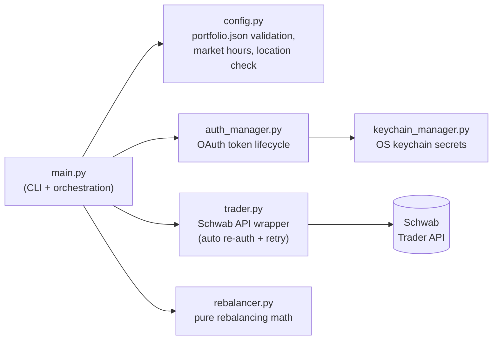

# Schwab Auto-Investor

[](https://github.com/tstinebaugh/schwab-auto-investor/actions/workflows/tests.yml)

[](LICENSE)

A command-line tool that invests idle cash in a Charles Schwab brokerage account according to a target ETF allocation. It talks to the official **Schwab Trader API** and uses a **buy-only rebalancing** algorithm: new money goes to whichever holdings are furthest below target, so the portfolio moves back toward its target weights **without ever selling** (and so without creating taxable gains).

I built it to automate the busywork of my monthly investing: one command works out exactly which shares to buy and places the orders. It handles real money, so most of the design is about correctness and safety: exact decimal math, a dry-run mode, typed confirmation before live orders, and secrets kept in the OS keychain rather than in files.

---

## Highlights

| Area | What it does |
| :--- | :--- |
| **Algorithm** | Buy-only rebalancing that sends new cash to the most underweight holdings, then converts dollars to whole shares and puts leftover cash into the next most underweight affordable ETF. |
| **Correctness** | All money math uses Python `Decimal` (no floating point). Allocations always add up to the exact cash available, to the penny. |
| **Security** | API keys are stored in the OS keychain (macOS Keychain, Windows Credential Locker, or Linux Secret Service). OAuth tokens are saved with `0600` file permissions. Optional check that the connection comes from a US IP. |
| **Safety rails** | `--dry-run` mode, a typed `YES` confirmation before live orders, a minimum-cash threshold, a market-hours check, GTC limit orders with a price-cap collar, and an option to use only settled cash. |
| **Resilience** | When an OAuth token expires or is rejected, the tool re-authenticates and retries the call automatically. Order submissions are spaced out to stay under Schwab's rate limit. When a run has no terminal attached (for example under cron), it fails fast instead of hanging. |
| **Testing** | 31 unit tests covering the rebalancing math, whole-share allocation, portfolio config validation, auth-error detection and retry, and live-order confirmation, all run in GitHub Actions CI. |

---

## Example

```text
$ python main.py rebalance --dry-run

[SECURITY OK] VPN location verified: Chicago, Illinois, US
[INFO] Cash Available for Rebalancing (cashBalance): $2,000.00  (Settled Cash: $2,000.00)
[INFO] Fetching real-time quotes to compute share quantities...

=== PROPOSED BUY-ONLY REBALANCE ALLOCATION ===
+----------+---------------+-------------+------------+--------------+---------+----------+------------+----------+
| Ticker   | Current Val   | Current %   | Target %   | Target ($)   | Price   |   Shares | Est Cost   | Post %   |
+==========+===============+=============+============+==============+=========+==========+============+==========+
| AVLV     | $10,000.00    | 49.5%       | 45.0%      | $0.00        | $68.10  |        0 | $0.00      | 45.1%    |
| DFAI     | $4,600.00     | 22.8%       | 25.0%      | $945.27      | $31.20  |       30 | $936.00    | 25.0%    |
| AVUV     | $2,900.00     | 14.4%       | 15.0%      | $427.86      | $95.40  |        4 | $381.60    | 14.8%    |
| AVDV     | $1,800.00     | 8.9%        | 10.0%      | $417.91      | $71.90  |        6 | $431.40    | 10.1%    |
| DFEM     | $900.00       | 4.5%        | 5.0%       | $208.96      | $28.60  |        8 | $228.80    | 5.1%     |
+----------+---------------+-------------+------------+--------------+---------+----------+------------+----------+
Total Capital to Deploy: $1,977.80

[DRY-RUN MODE] No orders were placed with Schwab API.
```

*Illustrative output with made-up balances (grid separators between rows trimmed). AVLV is above its target, so it gets no new money; the leftover cash after rounding down to whole shares goes to AVDV and DFEM.*

---

## How it works



Each run does the following:

1. **Load and validate** the target allocation from `portfolio.json`. Weights can be given as percentages or decimals, and must sum to 100%.
2. **Fetch** the account's cash balance and current positions from Schwab.
3. **Compute dollar allocations** (`calculate_buy_only_rebalance`). The tool works out what each holding *should* be worth once the new cash is invested, finds each holding's shortfall against that target, and splits the cash in proportion to the shortfalls. Overweight holdings get nothing. Rounding is corrected so the total equals the available cash exactly.
4. **Convert dollars to whole shares** (`allocate_whole_shares`). Each allocation is rounded down to whole shares. The leftover cash is then spent one share at a time on whichever affordable ticker is furthest below target, until no share fits.
5. **Show the plan**, and place market orders (or GTC limit orders) only after confirmation.

The rebalancing logic in `rebalancer.py` is made of pure functions with no I/O, so it is fully unit-tested without touching the Schwab API.

---

## Quick start

### Prerequisites

- Python 3.10+
- A Charles Schwab brokerage account
- An approved app on the [Schwab Developer Portal](https://developer.schwab.com) (gives you an App Key and App Secret). Set its callback URL to `https://127.0.0.1`.
- **The thinkorswim Terms of Service accepted on your Schwab account.** Without this, API orders can be accepted and then silently auto-canceled. See [Troubleshooting](#troubleshooting).

### Install

```bash
git clone https://github.com/tstinebaugh/schwab-auto-investor.git
cd schwab-auto-investor
python3 -m venv .venv && source .venv/bin/activate
pip install -r requirements.txt
```

### Configure credentials

```bash
python main.py setup
```

You'll be prompted for your App Key, App Secret, optional account hash (leave it blank and it is detected on first login), and callback URL. These are stored in your OS keychain, never on disk.

The first command that talks to Schwab opens a browser login. After you approve, Schwab redirects to `https://127.0.0.1/?code=...`. The page will fail to load; **that's expected**. Copy the full URL from the address bar and paste it into the terminal.

### Run

```bash
python main.py status                    # balances, holdings, current vs. target weights
python main.py rebalance --dry-run       # preview the trades
python main.py rebalance                 # place market orders (asks you to type YES)
```

---

## Commands and options

| Command | Description |
| :--- | :--- |
| `setup` | Store Schwab API credentials in the OS keychain |
| `clear` | Remove stored credentials |
| `auth` (`login`, `reauth`) | Force a fresh OAuth login |
| `status` | Show balances, target vs. current weights, and other holdings |
| `rebalance` | Compute and (optionally) execute buy-only rebalancing orders |

| `rebalance` flag | Effect |
| :--- | :--- |
| `--dry-run` | Show the plan without placing orders |
| `--gtc-limit` | Use Good-Til-Canceled limit orders instead of market orders. Use this outside market hours; orders fill at the next open. |
| `--price-cap-pct N` | Limit price = quote × (1 + N%). Default: 5 |
| `--settled-only` | Invest only fully settled cash, not the ledger cash balance |
| `--yes`, `-y` | Skip the confirmation prompt (for scheduled runs) |
| `--portfolio PATH` | Use a different allocation file (also available on `status`) |
| `--bypass-vpn` | Skip the US IP-location check (also available on `status` and `auth`) |

---

## Customizing the portfolio

Edit `portfolio.json`, or point `--portfolio` at another file:

```json
{
  "AVLV": 45,
  "DFAI": 25,
  "AVUV": 15,
  "AVDV": 10,
  "DFEM": 5
}
```

- Weights can be whole percentages (`45`, `"45%"`) or decimals (`0.45`), and must total 100% (or 1.0).
- Tickers are normalized to uppercase and validated (`BRK.B` and `BF-B` are accepted).
- Invalid files are rejected with a clear error before any API call is made.

### About the default allocation

The default portfolio is a factor-tilted global equity mix, inspired by the evidence-based investing approach popularized by Ben Felix (PWL Capital / *Rational Reminder*). It tilts toward the size, value, and profitability premiums documented in Fama-French research, using Avantis and Dimensional funds:

| Ticker | Fund | Weight | Role |
| :--- | :--- | :---: | :--- |
| AVLV | Avantis U.S. Large Cap Value ETF | 45% | U.S. large-cap value / profitability |
| DFAI | Dimensional International Core Equity Market ETF | 25% | Developed international core |
| AVUV | Avantis U.S. Small Cap Value ETF | 15% | U.S. small-cap value |
| AVDV | Avantis International Small Cap Value ETF | 10% | International small-cap value |
| DFEM | Dimensional Emerging Core Equity Market ETF | 5% | Emerging markets |

This is a sample configuration, not a recommendation. See the [disclaimer](#disclaimer).

---

## Why it's run by hand, not on a schedule

Schwab's OAuth setup rules out fully unattended investing:

- **Access tokens** last 30 minutes. The tool renews them automatically using the refresh token.
- **Refresh tokens** last **7 days** and **can't be extended or renewed through the API**. After 7 days Schwab rejects refresh requests, and the only fix is a new browser login (`python main.py auth`). This is documented in [schwab-py's authentication guide](https://schwab-py.readthedocs.io/en/latest/auth.html).

Your App Key and App Secret stay in the keychain and never expire. Only the OAuth token, stored in `~/.schwab/token.json`, does. Because a monthly job always runs more than 7 days after the last login, it would almost always find an expired token. So the intended workflow is to run the tool by hand once a month:

```bash
python main.py rebalance --dry-run   # log in if prompted, review the plan
python main.py rebalance             # place the orders
```

If you do want to schedule a run, for example to place orders a few days after an `auth` you ran by hand, the tool supports it safely:

- `--yes` skips the confirmation prompt. Without a terminal and without `--yes`, the tool refuses to place orders.
- If the token has expired, the run exits with code `2` and tells you to run `python main.py auth`, instead of hanging while it waits for a browser login.
- The run exits with a non-zero code if any order fails, so a monitoring wrapper can alert on it.

```cron
0 10 1 * * cd /path/to/schwab-auto-investor && .venv/bin/python main.py rebalance --yes >> rebalance.log 2>&1
```

---

## Running the tests

```bash
python -m unittest discover -s tests
```

The tests mock all Schwab API and keychain calls, so they need no credentials or network access.

---

## Troubleshooting

**Orders are accepted, then immediately auto-canceled.**
Schwab requires the thinkorswim Terms of Service and electronic trading agreements to be accepted before it executes API orders. Log in at [client.schwab.com](https://client.schwab.com), open **Trade → thinkorswim** (or launch thinkorswim web once), and accept any pending agreements.

**Orders are rejected because of unsettled funds.**
The Schwab website may give instant buying power for recent ACH deposits, but the API can reject orders until the funds settle (usually 1–3 business days). Wait, or use `--settled-only`.

**Orders are canceled outside market hours.**
Market orders placed outside regular trading hours (9:30 AM–4:00 PM ET) are canceled. Run during market hours, or use `--gtc-limit`.

---

## Limitations

- Places orders in whole shares only (no fractional shares).
- The market-hours check covers weekends and regular trading hours, but not exchange holidays or early closes.
- Uses the first brokerage account on the login unless an account hash is set with `setup`.
- Not fully unattended: Schwab requires a browser login at least every 7 days ([details](#why-its-run-by-hand-not-on-a-schedule)).
- Share counts are budgeted against the last quote. A market order can fill slightly higher if the price moves before execution.

---

## Disclaimer

This project is for educational and personal use. It is **not financial advice**, and the sample portfolio is not a recommendation. It places real orders in a real brokerage account. Review the code, use `--dry-run`, and use it at your own risk. The author is not affiliated with Charles Schwab, Avantis Investors, or Dimensional Fund Advisors.

## License

[MIT](LICENSE)
